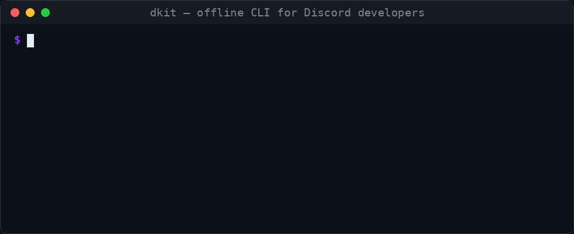

<h1 align="center">Hi, I'm Mattis 👋</h1>

<p align="center">
<b>I build tools for people who build Discord bots.</b> Discord bot developer from Germany.
</p>

<p align="center">
<a href="https://pypi.org/project/dkit-cli/"></a>
<a href="https://github.com/Bytewave1/dkit"></a>


</p>

<p align="center">

</p>

## dkit

Offline CLI for Discord developers: decode snowflakes, translate permission and intent bitfields, look up error codes, scopes, flags and channel types, build invite URLs. No network, no token.

```console
pip install dkit-cli
```

## Currently

Adding new lookup commands to dkit (components, rate limits, webhooks).

Reviewing contributions: there are [good first issues](https://github.com/Bytewave1/dkit/issues?q=is%3Aissue+is%3Aopen+label%3A%22good+first+issue%22) waiting.

## Elsewhere

[Discord](https://discord.com/users/1427987763596361851) · [PyPI](https://pypi.org/user/mattisdev123/)
